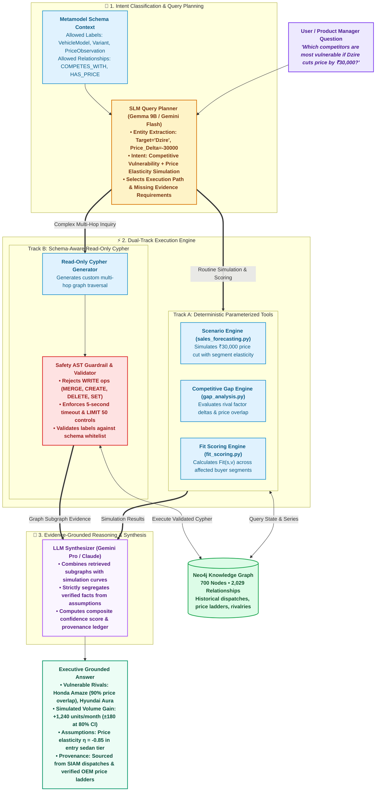
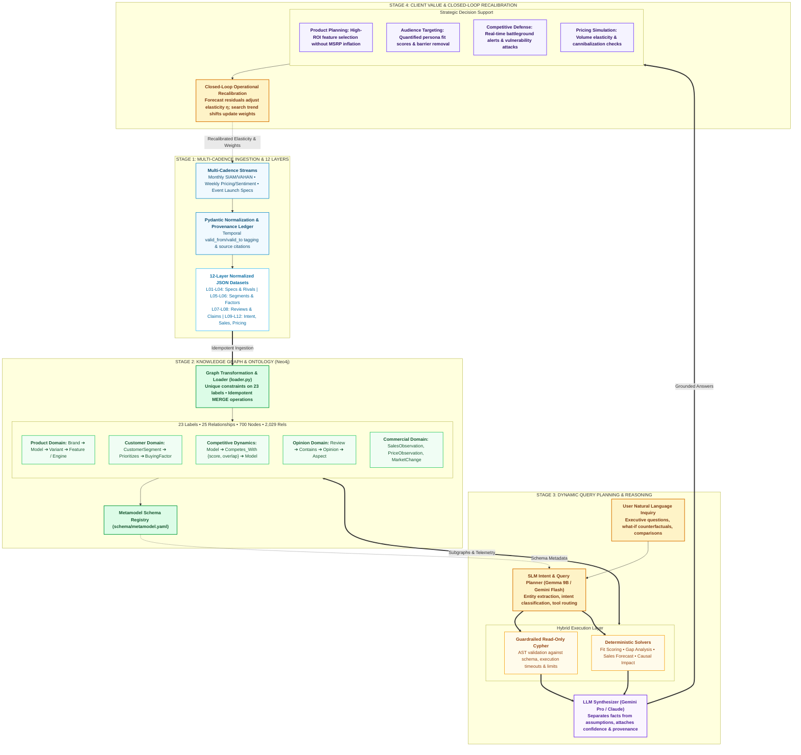

# 🚗 Automotive World Ontology: Production Architecture & Dynamic Query System

This document provides technical Mermaid diagrams reflecting the **production-grade reality** of the Automotive World Model:
1. **Multi-Cadence Data Ingestion** (Scheduled & Event-Triggered Batching, not unrealistic continuous streaming).
2. **Dynamic Querying Architecture** (SLM Intent & Query Planner ➔ Guardrailed Schema-Aware Cypher + Deterministic Solvers ➔ LLM Synthesizer).
3. **Closed-Loop Model Recalibration** (Feedback from observed market data into model parameters).

---

### 1. Dynamic Query Planning & Execution Architecture

This diagram illustrates how an open-ended natural-language question from an automotive executive or product manager is parsed, routed, and safely answered without hallucinating arbitrary Cypher:

---

### 2. Multi-Cadence Ingestion & Closed-Loop Recalibration

This diagram illustrates the **honest data lifecycle**: scheduled and event-triggered updates instead of unrealistic continuous streaming, coupled with a real model calibration loop:

```mermaid
flowchart LR
    %% STYLING
    classDef cadMonthly fill:#E0F2FE,stroke:#0284C7,stroke-width:2px,color:#075985
    classDef cadWeekly fill:#FEF9C3,stroke:#CA8A04,stroke-width:2px,color:#713F12
    classDef cadEvent fill:#FEE2E2,stroke:#DC2626,stroke-width:2px,color:#7F1D1D
    classDef valStyle fill:#FFFFFF,stroke:#38BDF8,stroke-width:1.5px,color:#0369A1
    classDef neoStyle fill:#DCFCE7,stroke:#16A34A,stroke-width:2px,color:#14532D,font-weight:bold
    classDef recalStyle fill:#FFF1F2,stroke:#E11D48,stroke-width:2px,stroke-dasharray: 5 5,color:#9F1239,font-weight:bold

    %% CADENCES
    subgraph CADENCES ["⏱️ Real-World Data Ingestion Cadences"]
        direction TB
        M_SIAM["<b>Monthly Scheduled:</b><br/>• SIAM OEM wholesale dispatches<br/>• VAHAN state-level registrations"]:::cadMonthly
        W_PRICE["<b>Weekly / Daily Scheduled:</b><br/>• Ex-showroom price adjustments<br/>• Forum sentiment (Team-BHP)<br/>• Search trend volumes"]:::cadWeekly
        E_LAUNCH["<b>Event-Triggered:</b><br/>• New vehicle & trim launches<br/>• Global NCAP crash ratings<br/>• Powertrain transitions"]:::cadEvent
    end

    %% VALIDATION
    subgraph NORMALIZATION ["🛡️ Extraction & Schema Normalization"]
        direction TB
        EXTRACT["<b>Pydantic Validation & Deduplication</b><br/>• Temporal tagging (valid_from, valid_to, is_current)<br/>• Source provenance & credibility tier assignment<br/>• Zero-vs-missing invariant enforcement"]:::valStyle
    end

    CADENCES --> EXTRACT

    %% NEO4J GRAPH
    subgraph GRAPH ["🕸️ Neo4j Knowledge Graph"]
        direction TB
        LOADER["<b>Idempotent MERGE Operations</b><br/>Preserves historical dispatches & price history without overwrites"]:::neoStyle
    end

    EXTRACT --> LOADER

    %% CLOSED LOOP RECALIBRATION
    subgraph RECALIBRATION ["🔄 Closed-Loop Operational Recalibration"]
        direction TB
        COMPARE["<b>Residual Calibration</b><br/>Compares predicted sales vs actual SIAM dispatches<br/>➔ Recalibrates price elasticity coefficients (η)"]:::recalStyle
        DRIFT["<b>Weight Drift Adaptation</b><br/>Detects shifts in search intent volume<br/>➔ Adjusts customer persona buying factor weights"]:::recalStyle
    end

    LOADER --> COMPARE
    LOADER --> DRIFT
    COMPARE -.->|Update Model Elasticity Parameters| CADENCES
    DRIFT -.->|Update Persona Factor Weights| CADENCES
```

---

### 3. Full Enterprise 4-Stage Architecture Blueprint

---

### 📁 Updated File Links
* Editable Draw.io file: [`automotive_intelligence_architecture.drawio`](file:///home/immortal/Desktop/Ontology/automotive_intelligence_architecture.drawio)
* Mermaid file: [`ARCHITECTURE_MERMAID.md`](file:///home/immortal/Desktop/Ontology/ARCHITECTURE_MERMAID.md)
* Executive documentation: [`system_architecture_diagram.md`](file:///home/immortal/.gemini/antigravity-ide/brain/e1407330-0f85-4175-a76e-53800cd82e81/system_architecture_diagram.md)
