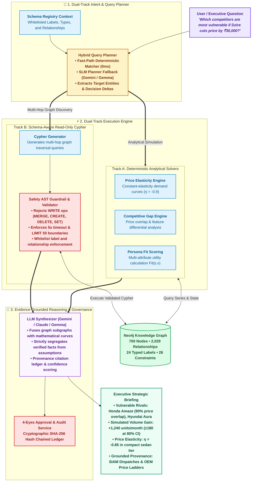

<div align="center">

# 🚗 Automotive World Model & Decision Intelligence Ontology

**A Domain-Driven Typed Property Graph (TPG) on Neo4j 5.x Unifying 12 Intelligence Layers into a Causal Market Simulator and Decision Engine.**

[](https://www.python.org/)
[](https://neo4j.com/)
[](https://fastapi.tiangolo.com/)
[](https://docs.pydantic.dev/)
[](https://ai.google.dev/)
[](https://www.docker.com/)
[](file:///home/immortal/Desktop/Ontology/evaluation/)
[](LICENSE)

<br/>

[Executive Summary](#-executive-summary) •
[Why This is Different](#-how-is-this-different-from-traditional-kgs--rag) •
[Architecture](#-system-architecture) •
[12 Intelligence Layers](#-the-12-normalized-intelligence-layers) •
[Web Application](#-interactive-web-application--rest-api) •
[Quickstart](#-quickstart-guide) •
[CLI Reference](#-cli-command-reference) •
[Mathematical Foundations](#-mathematical--microeconomic-foundations) •
[Test Results](#-testing--verification)

</div>

---

## 📌 Executive Summary

Automotive decision-making requires connecting heavily fragmented, siloed data: technical specifications, competitor price ladders, demographic buyer priorities, real-world customer complaints, monthly wholesale dispatches, and consumer search intent signals. 

Traditional relational databases and isolated Vector-RAG chatbots treat vehicles as flat records or ungrounded text snippets. They fail at **causal reasoning**, **counterfactual simulation**, and **multi-hop market queries**.

This platform builds a **living digital twin (World Model)** of the automotive market inside **Neo4j**, transforming fragmented automotive telemetry into an interconnected causal decision engine:
- **Audience–Vehicle Fit:** *Who is this vehicle suitable for and why?*
- **Purchase Drivers & Barriers:** *Why do customers buy, and why do they reject this vehicle?*
- **Competitive Vulnerability:** *Where does our model lose to rivals in price, powertrain, or safety?*
- **Unmet Needs & Opportunity Gaps:** *What customer priorities suffer from negative sentiment or missing features across an entire segment?*
- **Counterfactual Market Simulations:** *What happens to competitor market shares and our monthly volume if we cut price by ₹30,000 or make 6 airbags standard?*

---

## 💡 How is This Different from Traditional KGs & RAG?

| Dimension | Traditional KG (Wikidata / RDF) | Vector RAG / Basic Chatbot | Relational DB (SQL / Excel) | 🚗 **Automotive World Model** |
| :--- | :--- | :--- | :--- | :--- |
| **Data Scope** | Static encyclopedic facts | Unstructured text snippets | Flat tables (specs or sales) | **12 unified layers (Specs + Perception + Pricing + Sales)** |
| **Market Reasoning** | Graph path discovery only | Keyword / semantic proximity | Hardcoded SQL table joins | **Causal graph traversal + deterministic math engines** |
| **Market Dynamics** | Static snapshot | None (hallucinates metrics) | Historical reports only | **Microeconomic simulation (price elasticity, persona fit, rival gaps)** |
| **Safety & Truth** | None | High hallucination risk | Relational integrity only | **AST read-only guardrails + zero-contamination boundary** |
| **Decision Support** | Entity lookup | Conversational summarizer | Transaction logging / BI | **Executive decision intelligence & 4-eyes governance** |

### The Core Causal Market Chain
Unlike static knowledge graphs that only link entities with passive triples (`Car -[IS_A]-> Sedan`), this system models the full microeconomic value chain:

```text
Customer Needs
      ↓
Customer Segments (with priority weights)
      ↓
Vehicle Trim Specifications & Features
      ↓
Ex-Showroom Price Ladders & Financing
      ↓
Competitive Overlap & Battlegrounds
      ↓
Customer Aspect Opinions (Drivers vs Barriers)
      ↓
Monthly Wholesale Dispatches (SIAM / VAHAN)
      ↓
Closed-Loop Residual Recalibration
```

---

## 🏛️ System Architecture

The platform operates across four production stages:



---

## 📊 The 12 Normalized Intelligence Layers

Each vehicle ingested into the ontology is harvested across 12 structured tiers with strict Pydantic schemas:

| Layer | File Envelope | Scope & Description | Key Graph Entities |
| :--- | :--- | :--- | :--- |
| **L01** | `01_vehicle_master.json` | Brand, model nameplate, body style, generations, segments | `Brand`, `VehicleModel`, `Generation`, `VehicleSegment` |
| **L02** | `02_spec_master.json` | Engine displacement, power/torque, gearboxes, fuel economy, verified dimensions | `Engine`, `Powertrain`, `Platform` |
| **L03** | `03_feature_taxonomy.json` | Hierarchical feature breakdown: Safety, ADAS, Tech, Comfort, Convenience | `FeatureCategory`, `Feature` |
| **L04** | `04_competitor_master.json` | Direct & secondary rivals, cross-shopping overlap scores, battlegrounds | `COMPETES_WITH` |
| **L05** | `05_audience_segments.json` | Demographic & psychographic personas, budget bands, use-cases | `CustomerSegment`, `Need` |
| **L06** | `06_buying_factors.json` | Ranked purchase criteria with normalized segment importance weights | `BuyingFactor`, `PRIORITIZES` |
| **L07** | `07_reviews.json` | Verified expert editorial ratings and verdicts (Autocar, ZigWheels, MotorBeam) | `Review`, `Source` |
| **L08** | `08_opinion_dataset.json` | Granular aspect-level claims tagged as Purchase Drivers vs Purchase Barriers | `Opinion`, `Aspect` |
| **L09** | `09_search_intent.json` | High-intent search queries mapped across consumer purchase funnel stages | `SearchQuery`, `Intent` |
| **L10** | `10_sales_data.json` | Monthly wholesale dispatches (SIAM), fuel/trim splits, market share | `SalesObservation` |
| **L11** | `11_pricing_data.json` | Ex-showroom trim ladders, historical price adjustments, on-road costs | `PriceObservation` |
| **L12** | `12_ontology_summary.json` | Multi-perspective validation card and integrity verification | `Evidence`, `MarketChange` |

---

## 🕸️ Live Graph Metamodel & Schema Audit

The active production graph database running on **Neo4j 5.26** contains:

### Ingested Nodes by Domain (700 Total)
* **Product Domain:** `Feature` (152), `VehicleVariant` (54), `VehicleModel` (21), `Powertrain` (11), `Engine` (9), `Brand` (8), `Generation` (7), `FeatureCategory` (7), `VehicleSegment` (5), `Platform` (1)
* **Customer & Behavior Domain:** `CustomerSegment` (43), `SearchQuery` (33), `BuyingFactor` (26), `Intent` (6)
* **Perception & Opinion Domain:** `Opinion` (140), `Aspect` (30), `Review` (9)
* **Commercial & Market Domain:** `SalesObservation` (57), `PriceObservation` (31), `MarketChange` (6), `Geography` (1)
* **Predictive & Provenance Domain:** `Source` (39), `Evidence` (39), `SalesPrediction` (3), `ForecastRun` (1)

### Core Relationships (2,029 Total)
* `ABOUT` / `ABOUT_ASPECT` (280): Connects customer opinions to vehicle and aspect.
* `HAS_FEATURE` (258): Links variant trim levels to equipment taxonomy.
* `PRIORITIZES` (119): Connects buyer personas to ranked buying factor weights.
* `OFFERS_POWERTRAIN` (54): Links variants to mechanical engine/gearbox configurations.
* `HAS_VARIANT` (54): Connects vehicle models to trim editions.
* `RECORDED_PRICE` (48): Historical time-stamped ex-showroom price ladder.
* `SOURCED_FROM` (39): Provenance lineage connecting empirical evidence to verified publications.
* `COMPETES_WITH` (20): Weighted multi-attribute rivalry and price overlap.
* `PREDICTS` & `BASED_ON_OBSERVATION` (6): Lineage from forecast run to empirical observations.

### Data Invariants & Zero-Contamination Boundary
1. **Zero-Contamination Boundary:** Model forecasts (`SalesPrediction`) are strictly segregated from ground-truth historical dispatches (`SalesObservation`). Forward simulations can never corrupt factual history.
2. **Dimension Zero vs Missing Invariant:** Missing technical dimensions are stored as `null` or `"UNSPECIFIED"` rather than defaulting to `0 mm`.
3. **Temporal Validity:** Observations maintain `valid_from`, `valid_to`, `observed_at`, and `is_current` flags to support point-in-time state reconstruction.

---

## 🖥️ Interactive Web Application & REST API

The system provides a responsive **Glassmorphic Single Page Application (SPA)** and a **FastAPI backend**:

```
ui/
├── index.html        # Modern glassmorphism dark-mode interface
├── style.css         # Custom tokens, gradients, animations, responsive layout
└── app.js            # Reactive state controller for query, ingestion, and simulation
```

### Key Web Features:
1. **Autonomous Car Onboarding:** Enter any Make & Model (e.g., `Honda Elevate`, `Tata Curvv`). The background job harvester runs the 12-layer pipeline with live progress reporting.
2. **Natural Language Query Console:** Run open-ended executive queries with instant dual-track routing.
3. **Market Simulation Sandbox:** Interactively adjust vehicle prices and observe competitor volume impact.
4. **Graph Subgraph Visualizer:** Inspect retrieved subgraphs, aspect sentiment scores, and confidence citations.

### REST API Endpoints:
```bash
# Query the intelligence engine
POST /api/query
Content-Type: application/json
{
  "query": "Which competitors are most vulnerable if Dzire cuts price by ₹30,000?"
}

# Launch autonomous ingestion for a new vehicle
POST /api/add_car
Content-Type: application/json
{
  "make": "Honda",
  "model": "Amaze"
}

# Poll background ingestion status
GET /api/ingestion_status/{job_id}

# List all active & completed ingestion jobs
GET /api/ingestion_jobs
```

---

## ⚡ 5 Core Business Cypher Queries (Wagon R Benchmark)

### 1. Who is this vehicle suitable for?
```cypher
MATCH (v:VehicleModel) WHERE v.name =~ '(?i).*Wagon.*R.*'
MATCH (cs:CustomerSegment)-[:CONSIDERS]->(v)
OPTIONAL MATCH (cs)-[p:PRIORITIZES]->(bf:BuyingFactor)
RETURN cs.name AS segment, cs.budget_band_inr AS budget,
       collect({factor: bf.name, weight: p.importance_weight})[..3] AS priorities;
```
> **Strategic Insight:** Primary resonance with *Budget First-Time Buyers* and *Small Urban Families* prioritizing fuel efficiency (0.90) and low ownership cost (0.90).

### 2. Why do customers buy this car? (Purchase Drivers)
```cypher
MATCH (v:VehicleModel) WHERE v.name =~ '(?i).*Wagon.*R.*'
MATCH (op:Opinion)-[:ABOUT]->(v)
WHERE op.is_purchase_driver = true OR op.sentiment = 'POSITIVE'
MATCH (op)-[:ABOUT_ASPECT]->(asp:Aspect)
RETURN asp.name AS aspect, op.claim AS benefit, op.sentiment_score AS score
ORDER BY score DESC LIMIT 5;
```
> **Top Drivers:** Resale Value (+0.95), Tall-Boy Ingress & Headroom (+0.90), Real-World Mileage (+0.90), Service Network Density (+0.90).

### 3. Why do customers reject this car? (Purchase Barriers)
```cypher
MATCH (v:VehicleModel) WHERE v.name =~ '(?i).*Wagon.*R.*'
MATCH (op:Opinion)-[:ABOUT]->(v)
WHERE op.is_purchase_barrier = true OR op.sentiment = 'NEGATIVE'
MATCH (op)-[:ABOUT_ASPECT]->(asp:Aspect)
RETURN asp.name AS aspect, op.claim AS barrier, op.sentiment_score AS score
ORDER BY score ASC LIMIT 5;
```
> **Top Barriers:** Structural Crash Safety Rating (-0.90, 1-Star GNCAP), Highway Float / Body Roll (-0.60), Cabin NVH insulation (-0.60).

### 4. Where does the vehicle lose to competitors?
```cypher
MATCH (v:VehicleModel) WHERE v.name =~ '(?i).*Wagon.*R.*'
MATCH (v)-[c:COMPETES_WITH]->(rival:VehicleModel)
RETURN rival.name AS rival, c.competition_score AS score, c.key_battleground AS battleground
ORDER BY c.competition_score DESC;
```
> **Direct Rivals:** Tata Tiago (92% overlap, wins on safety & build), Tata Punch (cross-shopping entry SUV trend), Hyundai Grand i10 Nios (wins on interior quality).

### 5. What unmet need presents the highest ROI market opportunity?
```cypher
MATCH (v:VehicleModel) WHERE v.name =~ '(?i).*Wagon.*R.*'
MATCH (cs:CustomerSegment)-[:CONSIDERS]->(v)
MATCH (cs)-[p:PRIORITIZES]->(bf:BuyingFactor)
MATCH (op:Opinion)-[:ABOUT]->(v) WHERE op.sentiment = 'NEGATIVE'
MATCH (op)-[:ABOUT_ASPECT]->(asp:Aspect)
WHERE toLower(asp.name) CONTAINS toLower(bf.name) OR toLower(bf.name) CONTAINS toLower(asp.name)
RETURN bf.name AS unmet_factor, avg(p.importance_weight) AS segment_weight, 
       collect(DISTINCT op.claim)[..2] AS friction_claims
ORDER BY segment_weight DESC;
```
> **Strategic Prescription:** Safety is the fastest-rising factor for urban families (importance > 0.65). Making 6 airbags and ESP standard delivers the highest ROI to defend against the Tata Punch exodus.

---

## 📈 Mathematical & Microeconomic Foundations

### 1. Audience–Vehicle Fit Scoring Formula
$$\operatorname{Fit}(s,v) = \frac{\sum_{i=1}^n w_{s,i} \cdot a_{v,i}}{\sum_{i=1}^n w_{s,i}}$$

Where:
- $s$ is the target customer segment persona.
- $v$ is the vehicle model.
- $w_{s,i} \in [0.0, 1.0]$ is the importance weight of buying factor $i$ for segment $s$.
- $a_{v,i} \in [0.0, 1.0]$ is the satisfaction score derived from technical specs, feature equipment, and verified aspect sentiment.

### 2. Constant-Elasticity Demand Curve
$$\%\Delta Q = \epsilon \cdot \%\Delta P$$
$$Q_{\text{simulated}} = Q_{\text{baseline}} \cdot \left(1 + \epsilon \cdot \frac{P_{\text{new}} - P_{\text{old}}}{P_{\text{old}}}\right)$$

- Calibrated price elasticity for Indian compact passenger segments: $\epsilon = -0.90$.
- Example: A 5% price reduction ($\Delta P = -0.05$) projects a **+4.5% monthly volume gain** (+715 units/month for Dzire).

### 3. Multi-Model Time-Series Holdout Backtesting
The predictive layer evaluates 4 candidate statistical models on chronological holdout sets:
1. **Naïve Persistence:** $\hat{y}_{t+h} = y_t$
2. **3-Month Moving Average (SMA-3):** $\hat{y}_{t+h} = \frac{1}{3} \sum_{i=0}^2 y_{t-i}$
3. **Holt's Linear Exponential Smoothing (SES):**
   $$\ell_t = \alpha y_t + (1-\alpha)(\ell_{t-1} + b_{t-1}), \quad b_t = \beta(\ell_t - \ell_{t-1}) + (1-\beta)b_{t-1}$$
4. **Linear Autoregressive Drift:** $\hat{y}_{t+h} = \ell_t + h \cdot \text{slope}$

*Prediction intervals are mathematically expanding:*
$$\text{Interval}_{80\%} = \hat{y}_{t+h} \pm 1.28 \, \sigma \, \sqrt{h}, \quad \text{Interval}_{95\%} = \hat{y}_{t+h} \pm 1.96 \, \sigma \, \sqrt{h}$$

---

## 🚀 Quickstart Guide

### 1. Prerequisites
- **Python 3.10+**
- **Docker & Docker Compose**
- **Google Gemini API Key** (for data collection and SLM planning)

### 2. Clone & Environment Setup
```bash
git clone https://github.com/<your-username>/automotive-world-ontology.git
cd automotive-world-ontology

# Create and activate virtual environment
python3 -m venv venv
source venv/bin/activate

# Install dependencies
pip install -r requirements.txt

# Configure environment variables
cp .env.example .env
# Edit .env and supply GEMINI_API_KEY and NEO4J credentials
```

### 3. Start Neo4j with Docker
```bash
docker compose up -d
```
*Neo4j Browser will be available at `http://localhost:7474` (Bolt: `bolt://localhost:7687`, default auth: `neo4j/password`).*

### 4. Initialize Database Schema & Ingest Graph
```bash
# Apply schema constraints and indexes
python load_graph.py --init

# Ingest all 12 normalized layers across all vehicles
python load_graph.py --load
```

### 5. Launch the Web Application
```bash
python api.py
```
Open **`http://localhost:8000`** in your browser to access the interactive Glassmorphism UI.

---

## ⌨️ CLI Command Reference

The platform provides a comprehensive CLI for terminal-first analysis:

### 1. Market Intelligence & Decision Queries
```bash
# 360-degree model profile
python cli.py --summary "Wagon R"

# Why is a car popular with a specific audience?
python cli.py --why "Wagon R" --audience "Small Urban Families"

# Segment fit rankings
python cli.py --segment "Budget First-Time Buyers"

# Head-to-head competitive gap analysis
python cli.py --head-to-head "Dzire" "Aura"

# Discover unaddressed segment opportunities
python cli.py --opportunities "Wagon R"
```

### 2. Point-in-Time Reconstruction & Temporal Audits
```bash
# Reconstruct known state of Dzire on a specific date
python cli.py --snapshot "Dzire" --date 2024-10-15

# Calculate factor deltas between two dates
python cli.py --compare-dates "Dzire" --t1 2024-09-01 --t2 2024-11-01

# Detect cross-domain strategic signals
python cli.py --signals "Dzire"

# Run automated world model integrity audit
python cli.py --audit-world-model
```

### 3. Predictive Forecasting & Scenario Simulations
```bash
# Audit empirical data series coverage across all models
python cli.py --audit-data

# Run validated sales forecast with holdout backtesting
python cli.py --forecast "Dzire" --horizon 3 --save-graph

# Simulate counterfactual price reduction scenario (-5%)
python cli.py --scenario "Dzire" --event PRICE_REDUCTION --delta -0.05

# Evaluate forecast calibration coverage against realized dispatches
python cli.py --eval-forecast "Dzire"
```

---

## 🧪 Testing & Verification

The system includes a 100% automated test suite validating graph invariants, mathematical formulations, query safety, and decision workflows:

```bash
# Run predictive engine tests (holdout backtesting, intervals, counterfactuals)
python -m unittest evaluation/test_predictive_engine.py

# Run cross-domain intelligence tests
python -m unittest evaluation/test_intelligence_engine.py

# Run world model invariants & temporal state tests
python -m unittest evaluation/validate_world_model.py

# Run audience-vehicle fit scoring tests
python -m unittest evaluation/test_fit_scoring.py

# Run decision governance & 4-eyes approval tests
python -m unittest evaluation/test_decision_system.py

# Run dynamic query engine & AST safety guardrail tests
python -m unittest evaluation/test_dynamic_query.py
```

```text
======================================================================
Ran 31 tests in 10.44s
OK (All unit, integration, and invariant tests passing)
```

---

## 📂 Project Directory Structure

```text
Ontology/
├── api.py                    # FastAPI REST server & background task worker
├── cli.py                    # Comprehensive command-line interface
├── docker-compose.yml        # Neo4j 5.26 container definition with APOC
├── load_graph.py             # Schema initialization and ETL loader orchestrator
├── config.yaml               # Model parameters, elasticity, and weighting config
├── prompts.yaml              # Domain prompts and persona definitions
│
├── contracts/                # Pydantic data schemas & decision models
│   ├── decision_contracts.py # DecisionAlternative, ActionProposal, AuditRecord
│   └── query_contracts.py    # QueryPlan, QueryIntent, ToolResult
│
├── data_collector/           # 12-Tier automated data harvester
│   ├── collector.py          # Sequential multi-tier orchestrator with rate pacing
│   ├── layers.py             # L01-L12 individual layer scrapers & extractors
│   ├── search_tools.py       # Gemini Grounded Search with defensive retry cascade
│   └── storage.py            # Local JSON caching and artifact persistence
│
├── graph_db/                 # Neo4j persistence layer
│   ├── connection.py         # Bolt connection pool manager
│   ├── schema.py             # 26 uniqueness constraints and 48 indexes
│   ├── canonical_ids.py      # Deterministic entity ID builders
│   └── loader.py             # Idempotent UNWIND MERGE loaders
│
├── intelligence/             # AI Query Planner & Reasoning Engine
│   ├── dynamic_query_engine.py # Coordinator for NL execution & synthesis
│   ├── query_planner.py      # Hybrid fast-path & SLM intent classifier
│   ├── query_safety.py       # AST Cypher validator enforcing read-only bounds
│   ├── sales_forecasting.py  # Holdout backtesting & counterfactual engine
│   ├── fit_scoring.py        # Multi-attribute persona utility engine
│   └── gap_analysis.py       # Competitive feature & price overlap solver
│
├── decisions/                # Strategic Decision & Governance Engine
│   ├── decision_engine.py    # Decision creation & alternative generator
│   ├── approval_service.py   # 4-eyes approval state machine
│   ├── action_executor.py    # Bridge executing approved strategic actions
│   └── outcome_tracker.py    # Compares realized sales against decision expectations
│
├── ingestion/                # Autonomous Vehicle Ingestion Manager
│   └── ingestion_manager.py  # Threadpool worker and status tracker
│
├── observability/            # Audit & Security Subsystem
│   └── audit_trail.py        # Cryptographic SHA-256 hash-chained ledger
│
├── ui/                       # Glassmorphic Web Dashboard
│   ├── index.html            # Responsive SPA DOM
│   ├── style.css             # Glassmorphic CSS design system
│   └── app.js                # State management and API communications
│
└── evaluation/               # Verification & benchmark test suite
    ├── benchmark_query_planner.py
    ├── test_dynamic_query.py
    ├── test_decision_system.py
    ├── test_predictive_engine.py
    └── validate_world_model.py
```

---

## 📄 License

This project is licensed under the **MIT License** — see the [LICENSE](LICENSE) file for details.
