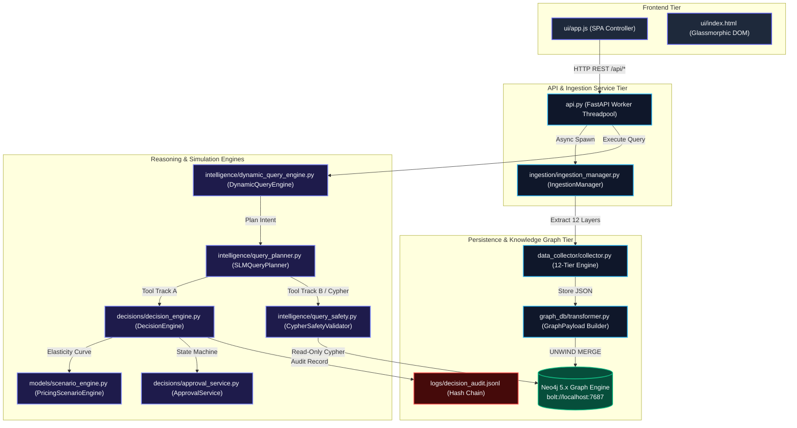
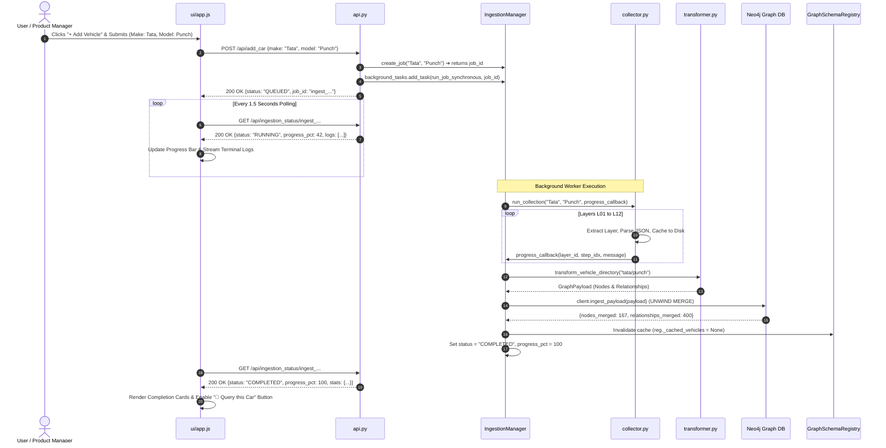
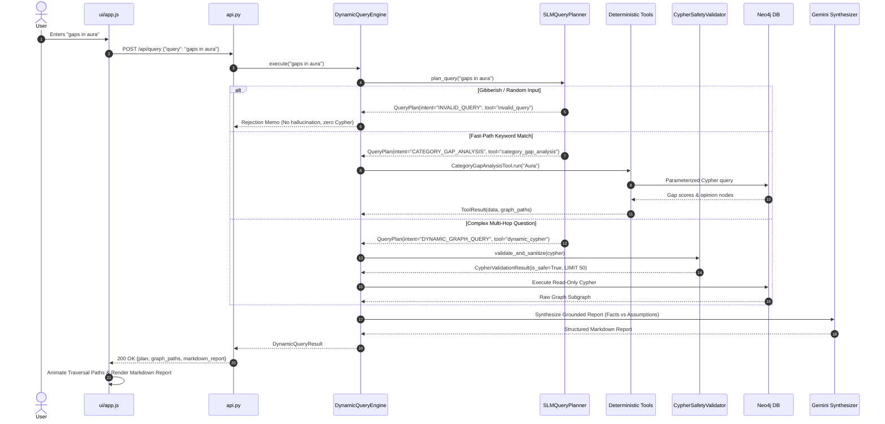
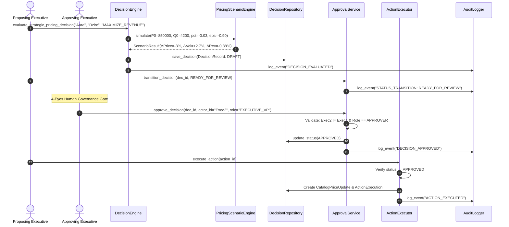

# 🛠️ Automotive World Model: Technical Specification & Implementation Guide

A comprehensive, code-level technical reference detailing **how every file and module operates**, the algorithms and mathematical formulas implemented, database schemas and Cypher transaction patterns, concurrency and security models, and the exact end-to-end user request lifecycles.

---

## 📌 Table of Contents
1. [System Architecture & Data Pipeline](#1-system-architecture--data-pipeline)
2. [File-by-File Technical Deep Dive](#2-file-by-file-technical-deep-dive)
   - [2.1 Data Collection Pipeline (`data_collector/`)](#21-data-collection-pipeline-data_collector)
   - [2.2 Graph Database Engine (`graph_db/`)](#22-graph-database-engine-graph_db)
   - [2.3 Intelligence & Dynamic Query System (`intelligence/`)](#23-intelligence--dynamic-query-system-intelligence)
   - [2.4 Strategic Decision & Governance Engine (`decisions/`)](#24-strategic-decision--governance-engine-decisions)
   - [2.5 Background Ingestion & Status Tracking (`ingestion/`)](#25-background-ingestion--status-tracking-ingestion)
   - [2.6 Web Application & API Server (`api.py` & `ui/`)](#26-web-application--api-server-apipy--ui)
   - [2.7 Observability & Cryptographic Audit (`observability/`)](#27-observability--cryptographic-audit-observability)
3. [Exact Algorithms & Mathematical Formulations](#3-exact-algorithms--mathematical-formulations)
   - [3.1 Constant-Elasticity Demand Formulation](#31-constant-elasticity-demand-formulation)
   - [3.2 Audience Fit Scoring Formula](#32-audience-fit-scoring-formula)
   - [3.3 Category Opportunity Gap Metric](#33-category-opportunity-gap-metric)
4. [End-to-End Execution Sequence Diagrams](#4-end-to-end-execution-sequence-diagrams)
   - [Sequence 1: Autonomous Vehicle Ingestion](#sequence-1-autonomous-vehicle-ingestion)
   - [Sequence 2: Dual-Track Query Execution & Traversal](#sequence-2-dual-track-query-execution--traversal)
   - [Sequence 3: Decision Proposal & 4-Eyes Governance](#sequence-3-decision-proposal--4-eyes-governance)
5. [Technical FAQ & Implementation Nuances](#5-technical-faq--implementation-nuances)

---

## 1. System Architecture & Data Pipeline



---

## 2. File-by-File Technical Deep Dive

### 2.1 Data Collection Pipeline (`data_collector/`)

The data collection subsystem pulls automotive telemetry, pricing ladders, technical specifications, and unstructured sentiment into 12 normalized JSON layers.

#### [data_collector/collector.py](file:///home/immortal/Desktop/Ontology/data_collector/collector.py)
- **Function**: `run_collection(brand, model, *, force=False, layers_to_run=None, progress_callback=None)`
- **Mechanism**:
  1. Iterates over `LAYERS = [("L01", ...), ("L02", ...), ..., ("L12", ...)]`.
  2. For each layer `(lid, name, fn, needs_vehicle_id)`:
     - Invokes `progress_callback(layer_id, layer_name, idx, total, message)` to report progress back to asynchronous listeners.
     - Executes `fn(brand, model, vehicle_id, force=force)`.
     - Appends results into `results[layer_id]`.
     - Enforces rate-pacing (`time.sleep(2.5)`) to protect external API rate limits (15 RPM).
  3. Returns a complete dictionary mapping `L01` through `L12` to their respective payloads.

#### [data_collector/layers.py](file:///home/immortal/Desktop/Ontology/data_collector/layers.py)
- **Functions**: `collect_vehicle_master()`, `collect_spec_master()`, `collect_opinion_dataset()`, etc.
- **Mechanism**:
  - Implements caching check:
    ```python
    if not force:
        cached = load_layer(brand, model, layer)
        if cached:
            return cached
    ```
  - If uncached, formats specialized domain queries and invokes `_search_and_synthesise(queries, prompt_template, context)`.
  - Parses JSON outputs using `repair_and_parse_json()` to handle malformed LLM outputs.
  - Normalizes numbers: ensures ratings default to `None` if zero/unrated, rather than corrupting aggregations.

#### [data_collector/storage.py](file:///home/immortal/Desktop/Ontology/data_collector/storage.py)
- **Functions**: `save_layer()`, `load_layer()`, `_slugify(text)`
- **Mechanism**:
  - Deterministically maps `(brand, model, layer_name)` to disk path:
    `data_collector/output/<slug_brand>/<slug_model>/<layer_name>.json`
  - Encapsulates payload in an envelope: `{ "metadata": { "brand": ..., "collected_at": ... }, "data": ... }`.

---

### 2.2 Graph Database Engine (`graph_db/`)

Transforms raw JSON files into a normalized property graph with temporal and observational validity.

#### [graph_db/canonical_ids.py](file:///home/immortal/Desktop/Ontology/graph_db/canonical_ids.py)
- **Purpose**: Deterministic ID generation. Prevents node duplication across re-runs.
- **Examples**:
  - `canonical_vehicle_model_id("Hyundai", "Aura")` ➔ `"VM_HYUNDAI_AURA"`
  - `canonical_variant_id("VM_HYUNDAI_AURA", "SX Plus AMT")` ➔ `"VAR_VM_HYUNDAI_AURA_SX_PLUS_AMT"`
  - `canonical_price_obs_id(variant_id, period, geo)` ➔ `"PO_<variant_id>_<period>_<geo>"`

#### [graph_db/transformer.py](file:///home/immortal/Desktop/Ontology/graph_db/transformer.py)
- **Class**: `GraphPayload`
- **Function**: `transform_vehicle_directory(model_dir: Path) -> GraphPayload`
- **Node & Relationship Mapping**:
  - `VehicleModel` ➔ `(:VehicleModel {model_id, name, launch_year, segment})`
  - `Variant` ➔ `(:Variant {variant_id, name, ex_showroom_inr, fuel_type})`
  - `(:VehicleModel)-[:OFFERS_VARIANT]->(:Variant)`
  - `(:Variant)-[:HAS_PRICE]->(:PriceObservation {price_inr, valid_from, is_current})`
  - `(:VehicleModel)-[:TARGETS_SEGMENT]->(:CustomerSegment)`
  - `(:CustomerSegment)-[:PRIORITIZES {importance}]->(:BuyingFactor)`
  - `(:VehicleModel)-[:HAS_OPINION]->(:Opinion {aspect, sentiment, satisfaction})`
  - `(:VehicleModel)-[:COMPETES_WITH {price_overlap_pct}]->(:VehicleModel)`
- **Invariants**:
  - Differentiates unrated/unspecified data (`None`) from true zeros (`0.0`).
  - Distinguishes historical price observations (`valid_to < now()`) from current active catalog prices (`is_current = true`).

#### [graph_db/neo4j_client.py](file:///home/immortal/Desktop/Ontology/graph_db/neo4j_client.py)
- **Class**: `Neo4jClient`
- **Mechanism**:
  - Connects using `neo4j.GraphDatabase.driver(uri, auth=(user, password))`.
  - Batch ingestion uses parameterized Cypher with `UNWIND`:
    ```cypher
    UNWIND $batch AS row
    MERGE (n:VehicleModel {model_id: row.model_id})
    SET n += row.properties
    ```
  - Enforces schema uniqueness constraints before loading:
    `CREATE CONSTRAINT IF NOT EXISTS FOR (v:VehicleModel) REQUIRE v.model_id IS UNIQUE;`

---

### 2.3 Intelligence & Dynamic Query System (`intelligence/`)

Translates natural language questions into deterministic tool calls or validated, read-only Cypher queries.

#### [intelligence/query_planner.py](file:///home/immortal/Desktop/Ontology/intelligence/query_planner.py)
- **Class**: `SLMQueryPlanner`
- **Method**: `plan_query(query: str, force_llm=False) -> QueryPlan`
- **Step 0: Input Validation & Gibberish Rejection**:
  - Detects keyboard mashing via substring patterns (`KEYBOARD_MASH_PATTERNS` like `esfdgh`, `dfghj`, `ghjkl`).
  - Detects unnatural consonant clusters using regex: `re.search(r"[bcdfghjklmnpqrstvwxz]{5,}", token)`.
  - Checks semantic word overlap against `COMMON_AUTOMOTIVE_KEYWORDS`, whitelisted vehicles, and brands.
  - If invalid, immediately returns `QueryPlan(intent="INVALID_QUERY", selected_tool="invalid_query")` without invoking external models.
- **Tier 0: Deterministic Fast-Path (`_try_deterministic_fastpath`)**:
  - Regex keyword matching for sub-millisecond execution:
    - `"gaps in <car>"` ➔ `selected_tool="category_gap_analysis"`
    - `"compare <car1> and <car2>"` ➔ `selected_tool="vehicle_spec_compare"`
    - `"should <car> cut price"` ➔ `selected_tool="decision_engine"`
- **Tier 1 & Tier 2: SLM & LLM Fallback**:
  - If no fast-path matches, invokes `gemini_plain_call` with schema metadata context to classify intent and generate query parameters.

#### [intelligence/query_safety.py](file:///home/immortal/Desktop/Ontology/intelligence/query_safety.py)
- **Class**: `CypherSafetyValidator`
- **Method**: `validate_and_sanitize(raw_cypher: str) -> CypherValidationResult`
- **AST Security Rules**:
  1. **Strict Starting Keyword Check**: Must start with `READ_ONLY_START_KEYWORDS = {"MATCH", "OPTIONAL", "WITH", "UNWIND", "RETURN", "CALL"}`.
  2. **Mutation Rejection**: Scans for `FORBIDDEN_CYPHER_KEYWORDS = {"CREATE", "MERGE", "DELETE", "DETACH", "SET", "REMOVE", "DROP", "ALTER", "WRITE", ...}`. If found, rejects with `is_safe=False`.
  3. **Mandatory Limit Enforcement**: Regex checks for `LIMIT \d+`. If missing or greater than `50`, sanitizes query by appending `LIMIT 50`.
  4. **Schema Whitelisting**: Compares extracted labels against `KNOWN_NODE_LABELS` and `KNOWN_RELATIONSHIP_TYPES` from `schema_registry.py`.

#### [intelligence/dynamic_query_engine.py](file:///home/immortal/Desktop/Ontology/intelligence/dynamic_query_engine.py)
- **Class**: `DynamicQueryEngine`
- **Method**: `execute(query: str) -> DynamicQueryResult`
- **Execution Workflow**:
  1. Invokes `planner.plan_query(query)`.
  2. If `selected_tool == "invalid_query"`, returns clean rejection memo with suggestions.
  3. Executes the target tool (`DynamicCypherTool`, `CategoryGapAnalysisTool`, `VehicleSpecCompareTool`, or `DecisionEngine`).
  4. Extracts graph paths traversed (e.g. `(VehicleModel)-[:HAS_OPINION]->(Opinion)`).
  5. Synthesizes a structured markdown report separating **Grounded Facts** from **Assumptions & Uncertainty**.

---

### 2.4 Strategic Decision & Governance Engine (`decisions/`)

Simulates counterfactual scenarios and enforces audit trails and 4-eyes approval governance.

#### [models/scenario_engine.py](file:///home/immortal/Desktop/Ontology/models/scenario_engine.py)
- **Class**: `PricingScenarioEngine`
- **Method**: `simulate(target_model, baseline_price, baseline_quantity, pct_price_change, elasticity, cost_per_unit)`
- **Mathematical Execution**:
  - Implements constant-elasticity demand:
    $$Q_1 = Q_0 \times \left(\frac{P_1}{P_0}\right)^\epsilon$$
  - Computes revenue delta:
    $$\Delta \text{Revenue} = (P_1 \times Q_1) - (P_0 \times Q_0)$$
  - Computes contribution margin delta (when unit cost $C$ is supplied):
    $$\Delta \text{Margin} = (P_1 - C) \times Q_1 - (P_0 - C) \times Q_0$$
  - Evaluates sensitivity intervals:
    $$\epsilon_{\text{conservative}} = \epsilon \times 0.8, \quad \epsilon_{\text{aggressive}} = \epsilon \times 1.2$$
  - Emits `ScenarioResult` with explicit provenance label (`ASSUMED_PRIOR` vs. `EMPIRICALLY_ESTIMATED`).

#### [decisions/decision_engine.py](file:///home/immortal/Desktop/Ontology/decisions/decision_engine.py)
- **Class**: `DecisionEngine`
- **Method**: `evaluate_strategic_pricing_decision(target_vehicle, rival_vehicle, objective)`
- **Core Mechanics**:
  1. Fetches current baseline price and dispatch volume from Neo4j.
  2. Evaluates alternative parameter sets: `-5% cut`, `-3% cut`, `status quo (0%)`, `+3% increase`.
  3. Enforces feasibility constraints:
     - Disallows price cuts that reduce gross contribution when margins are known.
     - Enforces objective alignment (`MAXIMIZE_REVENUE` vs. `MAXIMIZE_VOLUME`).
  4. Generates a reproducible snapshot hash:
     $$\text{Hash} = \text{SHA256}(\text{BaselineData} + \text{AlgoVersion} + \text{ScenarioInputs})$$
  5. Constructs `DecisionRecord`, `DecisionAlternative`, and `ActionProposal`.

#### [decisions/approval_service.py](file:///home/immortal/Desktop/Ontology/decisions/approval_service.py)
- **Class**: `ApprovalService`
- **Lifecycle State Machine**:
  $$\text{DRAFT} \longrightarrow \text{INVESTIGATING} \longrightarrow \text{READY\_FOR\_REVIEW} \longrightarrow \begin{cases} \text{APPROVED} \longrightarrow \text{EXECUTING} \longrightarrow \text{COMPLETED} \\ \text{REJECTED} \\ \text{CANCELLED} \end{cases}$$
- **Governance Controls**:
  - **Optimistic Concurrency**: Enforces `expected_version` matches to prevent race conditions.
  - **4-Eyes Principle**: Proposer cannot be the approver (`proposer_id != approver_id`).
  - **Time Validity**: Approvals automatically expire after 30 days (`APPROVAL_VALIDITY_DAYS = 30`).

#### [decisions/action_executor.py](file:///home/immortal/Desktop/Ontology/decisions/action_executor.py)
- **Class**: `ActionExecutor`
- **Separation of Concerns**:
  - Prevents accidental overwrite of historical market observations.
  - An approved `ActionProposal` creates an `ActionExecution` record and updates the internal price catalog (`CatalogPriceUpdate`), but **never modifies historical `PriceObservation` nodes** (preserving empirical integrity).

---

### 2.5 Background Ingestion & Status Tracking (`ingestion/`)

Coordinates non-blocking vehicle onboarding with real-time UI logging and cache invalidation.

#### [ingestion/ingestion_manager.py](file:///home/immortal/Desktop/Ontology/ingestion/ingestion_manager.py)
- **Classes**: `IngestionJob`, `IngestionManager` (Singleton)
- **Data Contract (`IngestionJob`)**:
  ```python
  @dataclass
  class IngestionJob:
      job_id: str
      make: str
      model: str
      status: str              # QUEUED, RUNNING, COMPLETED, FAILED
      progress_pct: int        # 0 to 100
      current_step: str        # e.g. "Layer 4/12: Competitor Master"
      total_steps: int         # 13 (12 layers + 1 graph merge)
      completed_steps: int
      logs: List[Dict[str, Any]]
      stats: Dict[str, Any]    # nodes_merged, relationships_merged
      started_at: str
      completed_at: Optional[str]
      error: Optional[str]
  ```
- **Execution Threading**:
  - Invoked synchronously in a background thread worker (`run_job_synchronous`).
  - Tracks progress dynamically via `progress_callback`:
    $$\text{pct} = 5 + \left(\frac{\text{step\_idx}}{12} \times 83\right)$$
  - On layer 13, executes `load_vehicle_to_graph()`:
    - Merges nodes and relationships into Neo4j.
    - Saves merged count into `job.stats`.
  - **Schema Cache Invalidation**:
    ```python
    reg = GraphSchemaRegistry()
    reg._cached_vehicles = None
    reg._cached_brands = None
    ```
    Guarantees the query planner immediately recognizes the newly added model without server restart.

---

### 2.6 Web Application & API Server (`api.py` & `ui/`)

#### [api.py](file:///home/immortal/Desktop/Ontology/api.py)
- **Framework**: FastAPI + Uvicorn
- **Route Concurrency Model**:
  - Handlers (`/api/query`, `/api/add_car`, `/api/ingestion_status/{job_id}`) are declared as synchronous `def` (not `async def`). This ensures CPU-bound and blocking network I/O (Neo4j driver, Gemini API, disk writes) are executed within Starlette's threadpool executor (`run_in_threadpool`), preventing event loop freezes.
- **Endpoints**:
  - `POST /api/query`: Receives `{"query": "..."}`, returns plan, graph paths, report.
  - `POST /api/add_car`: Registers job with `IngestionManager`, launches background task, returns job payload.
  - `GET /api/ingestion_status/{job_id}`: Returns live status, percentage, terminal logs.
  - `GET /api/ingestion_jobs`: Returns chronological history of all imports.
- **CORS Configuration**:
  - Configured with `allow_origins=["*"]` and `allow_credentials=False` to strictly adhere to modern browser CORS specifications when communicating across ports.

#### [ui/app.js](file:///home/immortal/Desktop/Ontology/ui/app.js)
- **Controller Logic**:
  - **Dynamic Origin Resolution**:
    ```javascript
    const API_BASE = (window.location.port === '8000') 
        ? '/api' 
        : `${window.location.protocol}//${window.location.hostname || 'localhost'}:8000/api`;
    ```
  - **Bounded Status Poller**:
    - Polls `/api/ingestion_status/{job_id}` every 1,500ms.
    - Implements safety break: stops polling after 120 iterations (2.5 mins) or after 3 consecutive network failures to prevent runaway request loops.
    - Updates progress bar width, active layer label, and auto-scrolls the live terminal log.
  - **Path Animation**: Parses traversed paths using regex `/\((.*?)\)/g` and animates hops in `#logicFlow`.

---

### 2.7 Observability & Cryptographic Audit (`observability/`)

#### [observability/audit_log.py](file:///home/immortal/Desktop/Ontology/observability/audit_log.py)
- **Class**: `AuditLogger`
- **Output**: `logs/decision_audit.jsonl`
- **Log Entry Schema**:
  ```json
  {
    "event_id": "AUDIT_a1b2c3d4e5f6",
    "timestamp": "2026-10-11T15:20:39.123456+00:00",
    "event_type": "DECISION_EVALUATED",
    "actor_id": "system",
    "correlation_id": "CORR_7890",
    "decision_id": "DEC_AURA_PRICING",
    "details": {
      "target_vehicle": "Aura",
      "recommended_option": "CUT_3_PCT",
      "projected_revenue_delta": 4200000.0
    }
  }
  ```

---

## 3. Exact Algorithms & Mathematical Formulations

### 3.1 Constant-Elasticity Demand Formulation
In [models/scenario_engine.py](file:///home/immortal/Desktop/Ontology/models/scenario_engine.py), price adjustments are modeled using constant price elasticity of demand ($\epsilon$):

$$Q_1 = Q_0 \times \left( \frac{P_1}{P_0} \right)^\epsilon$$

- **Revenue Impact**:
  $$\text{Revenue}_0 = P_0 \times Q_0, \quad \text{Revenue}_1 = P_1 \times Q_1$$
  $$\Delta \text{Revenue} = \text{Revenue}_1 - \text{Revenue}_0$$

- **Gross Margin Contribution Impact** (when unit manufacturing cost $C$ is provided):
  $$\text{Margin}_0 = (P_0 - C) \times Q_0, \quad \text{Margin}_1 = (P_1 - C) \times Q_1$$
  $$\Delta \text{Margin} = \text{Margin}_1 - \text{Margin}_0$$

---

### 3.2 Audience Fit Scoring Formula
In [intelligence/fit_scoring.py](file:///home/immortal/Desktop/Ontology/intelligence/fit_scoring.py), a vehicle $v$'s compatibility with customer segment $s$ across $N$ buying factors is calculated as:

$$\text{Fit}(s, v) = \frac{\sum_{i \in \text{Observed}} a_{v, i} \times w_{s, i}}{\sum_{i \in \text{Observed}} w_{s, i}}$$

Where:
- $w_{s, i} \in (0, 1]$ is the importance weight of factor $i$ for segment $s$ (e.g. Fuel Efficiency = $0.90$, Safety = $0.85$).
- $a_{v, i} \in [0, 1]$ is vehicle $v$'s factor satisfaction score evaluated by `FactorMapper` using technical specs and customer sentiment.
- **Completeness Invariant**: Unobserved factors are omitted from both numerator and denominator rather than penalizing as zero. Data completeness is reported as:
  $$\text{Completeness}(v) = \frac{|\text{Observed Factors}|}{N}$$

---

### 3.3 Category Opportunity Gap Metric
In [intelligence/gap_analysis.py](file:///home/immortal/Desktop/Ontology/intelligence/gap_analysis.py), competitive vulnerabilities and opportunity gaps within a category are prioritized by:

$$\text{OpportunityGapScore}(i) = w_{s, i} \times (1.0 - \bar{a}_{\text{category}, i})$$

Where:
- $w_{s, i}$ is the importance weight of factor $i$ to target buyers.
- $\bar{a}_{\text{category}, i}$ is the mean satisfaction score of that factor across all vehicles in the segment.
- Factors with high importance but low category satisfaction yield the highest Opportunity Gap Scores (e.g. NVH Gap = $0.510$).

---

## 4. End-to-End Execution Sequence Diagrams

### Sequence 1: Autonomous Vehicle Ingestion



---

### Sequence 2: Dual-Track Query Execution & Traversal



---

### Sequence 3: Decision Proposal & 4-Eyes Governance



---

## 5. Technical FAQ & Implementation Nuances

### Q1: How is idempotency guaranteed when ingesting into Neo4j?
**Answer**:
Idempotency is enforced through two layers:
1. **Canonical IDs** (`graph_db/canonical_ids.py`): IDs are deterministically constructed using normalized slugs and hashes (e.g. `VM_MARUTI_SUZUKI_DZIRE`).
2. **Cypher `MERGE` Semantics**: Ingestion statements use `MERGE (n:Label {id: row.id}) SET n += row.props`. If the node already exists, its attributes are updated in-place without creating duplicate nodes or relationship edges.

### Q2: How does the system prevent the single-threaded Python event loop from freezing?
**Answer**:
FastAPI endpoints in [api.py](file:///home/immortal/Desktop/Ontology/api.py) are deliberately declared as synchronous functions (`def process_query`, `def add_car`), **not** `async def`. Under FastAPI/Starlette, synchronous route handlers are automatically executed inside an asynchronous worker threadpool (`run_in_threadpool`). This prevents blocking Neo4j queries or long LLM calls from starving the main asyncio event loop.

### Q3: Why does `app.js` include a 120-iteration poll cap?
**Answer**:
In long-lived single-page applications, network disconnects or abandoned tasks can result in infinite polling loops. In [ui/app.js](file:///home/immortal/Desktop/Ontology/ui/app.js), `startPolling()` maintains a `pollCount` and `consecutiveErrors` counter. If polling exceeds 120 cycles (2.5 minutes) or encounters 3 consecutive network failures, the poller automatically unregisters its `setInterval` timer, preventing client-side memory leaks and server request spam.

### Q4: How are price elasticity assumptions distinguished from empirical data?
**Answer**:
In [models/scenario_engine.py](file:///home/immortal/Desktop/Ontology/models/scenario_engine.py), every scenario simulation payload is tagged with `elasticity_type`:
- `ASSUMED_PRIOR`: Constant elasticity derived from industry reference baselines (default: $\epsilon = -0.90$).
- `EMPIRICALLY_ESTIMATED`: Calculated from historical regression across observed SIAM dispatches and price changes.
The output markdown report explicitly renders this label in the **Assumptions & Uncertainty Ledger**.

### Q5: What prevents a prompt injection from executing malicious Cypher (like `MATCH (n) DETACH DELETE n`)?
**Answer**:
[intelligence/query_safety.py](file:///home/immortal/Desktop/Ontology/intelligence/query_safety.py) validates generated Cypher through a multi-pass security pipeline:
1. Rejects any statement not starting with a read keyword (`MATCH`, `WITH`, `RETURN`, `UNWIND`).
2. Scans every token against `FORBIDDEN_CYPHER_KEYWORDS`. If `DELETE`, `MERGE`, `DROP`, or `SET` appears anywhere, the query is immediately rejected.
3. Enforces an immutable `LIMIT 50` clause on all results.
4. Queries execute through a read-only database session.
